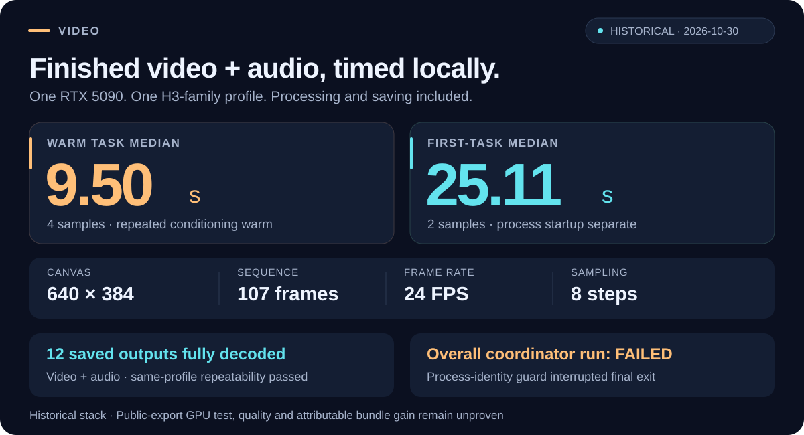

<h1 align="center">Local Video Engine</h1>

<p align="center"><strong>9.50 seconds per warm audiovisual task on one RTX 5090.</strong><br>
Local execution. Unchanged stored weights. Measured results with their limits.</p>

<p align="center">
  <a href="#measured-local-performance">Performance</a> &nbsp;·&nbsp;
  <a href="benchmarks/comparison.md">Comparisons</a> &nbsp;·&nbsp;
  <a href="#setup">Setup</a> &nbsp;·&nbsp;
  <a href="backends/wangp/README.md">Runtime guide</a> &nbsp;·&nbsp;
  <a href="LICENSES.md">Licenses</a>
</p>



**Explore the full comparison: [30 local project groups](benchmarks/comparison.md#local-projects-covered) · [7 frontier services](benchmarks/comparison.md#frontier-services) · [machine-readable data](benchmarks/comparison.json).**

The engine accelerates repeated local work through reference caching, CUDA graph
reuse and finite-batch residency. Stored model weights stay unchanged, and
inference runs locally with no hosted fallback. Ordinary batching uses compatible
models supported by WanGP; graph reuse and GPU retention have specific H3
admission rules in the [runtime guide](backends/wangp/README.md). No models,
prompts, media or private configurations are included.

## Measured local performance

| Measurement | Historical result | Scope |
| --- | --- | --- |
| Warm task median | **9.50 s** | Four tasks; repeated input conditioning was warm |
| First-task median | **25.11 s** | Two tasks; process startup is separate |
| Hardware | One RTX 5090 | Historical FastH3-family local reference profile |
| Output | 640 × 384 · 107 frames · 24 FPS | Video with audio |
| Sampling | Eight steps | One profile, not a benchmark of every supported model |
| Task clock | Processing and saving included | Not denoising time alone |

These numbers come from completed tasks in a **historical development-stack run**.
The full coordinator failed its process-identity guard before final exit. A
separate audit fully decoded video and audio for **12 saved outputs** and passed
same-profile repeatability checks; the overall run remains failed.

This is not a fresh GPU test of the public export, proof of video quality, or a
measured speedup attributable to the complete patch bundle. Fresh arbitrary-input
latency is not established. One-second fresh finished audiovisual generation has
not been achieved. See the [sample times and limits](benchmarks/reference.json),
[benchmark method](benchmarks/protocol.md) and the backend's
[historical graph OFF/ON comparison](backends/wangp/README.md).

## How the published alternatives compare

Selected official results below were checked on **2026-10-30**. External numbers
are **publisher-reported and were not reproduced here**. These are different
workloads, so the table is not a speed ranking. NR means the timing statement did
not report that field.

| Project / official source | Reported time | Hardware | Workload and timing differences |
| --- | --- | --- | --- |
| [FastVideo / FastWan-QAD-1.3B](https://haoailab.com/blogs/fastwan-qad/) | **1.8 s** | 1 × RTX 5090 | 480p, 5 s requested, frames NR; three distilled steps, FP4 and a tiny decoder. Publisher E2E; audio, startup/compile boundaries and warm state NR. |
| [LightX2V / LightWan2.2-A14B](https://huggingface.co/lightx2v/LightWan2.2-A14B/blob/a6f09bcd5ffbd079e7397cb7c185691a13445af7/README.md) | **14.15 s** | 1 × RTX 5090 | 480p, four-step NVFP4/sparse recipe. Author E2E table; frames, audio, startup and warm state NR. |
| [FastVideo / FastH3 Omni](https://haoailab.com/blogs/fastvideo-omniref-update/) | **5.67 s mean** | 8 × GB200 | 768p, 124 frames, 24 FPS, eight steps, audio. One-image reference; one warmup then three seeds, conditioning caches disabled. Client time through completed MP4; model loading/server startup excluded. |
| [NVIDIA Sol Engine / MiniMax H3](https://nvlabs.github.io/Sana/Sol-Engine/H3-OnDevice/) | **231.2 s** | 1 × RTX 5090 | 768p, 124 frames, 24 FPS, 50 steps, audio; warm batch 1. Publisher E2E includes VAE/fixed costs; saved-file boundary not independently checked. Sparse attention and cross-step caching. |

FastWan's 1.8-second result uses a distilled 1.3B model, three steps and a tiny
decoder; its audio timing is not reported. It is a different job from our
eight-step H3 audiovisual task. A shared GPU model does not make the jobs equal.
The [full local comparison](benchmarks/comparison.md#published-local-speed-results)
also separates finished-file time, seconds per frame and streaming FPS.

For frontier services, the [Veo documentation](https://ai.google.dev/gemini-api/docs/veo?hl=en)
gives an **11-second to 6-minute request range**, but the reviewed Veo 3.1 preview
endpoints retired on 2026-10-22. That range is service guidance, with no matched
hardware, warm state or queue-free finished-download timing. It is not a current
preview benchmark. The [seven-service frontier catalog](benchmarks/comparison.md#frontier-services)
covers Veo, Sora, Runway, Luma, Kling, Pika and Hailuo, preserving unknown elapsed
times, Sora's discontinuation and availability caveats. We did not submit prompts
or media to any hosted service. No frontier-quality or universal fastest-engine
claim is established.

## Setup

Python 3.10+ and Git are needed for the patch tool. Start with a separate runtime
checkout, then apply the pinned source patch:

```shell
git clone https://github.com/deepbeepmeep/WanGP.git video-runtime
git -C video-runtime checkout 2c67e50c8ed2c7074b4060bf6d6372af593a55ec
python tools/engine.py apply wangp --checkout ./video-runtime
```

[Install the runtime and run a batch](backends/wangp/README.md#run-a-finite-local-batch)
with your own compatible local models, config, manifest and FFmpeg installation.
The [backend instructions](backends/wangp/README.md) cover dependencies, a dry run,
optional speed settings and CPU tests. Check free GPU/CPU/RAM before generation.

## Checks and licenses

```shell
python -B -m unittest discover -s tests
python tools/check_release.py --check
```

Original top-level tools use [Apache-2.0](LICENSE). WanGP-derived patches, adapter
and tests use [WanGP Community License 2.0](backends/wangp/LICENSE.txt), with its own
redistribution and commercial-use terms. Read [LICENSES.md](LICENSES.md) and
[the notices](THIRD_PARTY_NOTICES.md). Model licenses remain separate.
